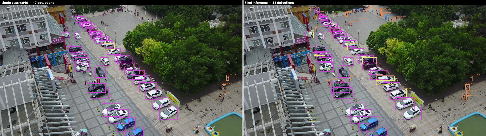
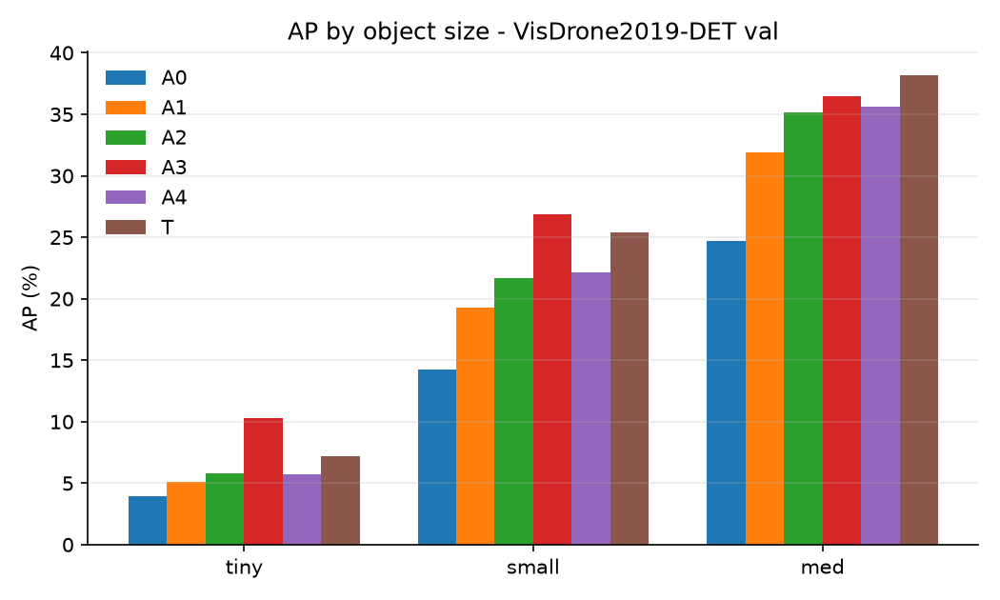

# TinyDet — anchor-free small-object detection for drone imagery

A detector whose head, losses, assigners and training loop are written from scratch,
trained on **VisDrone2019-DET** to answer one question with numbers: *which design
choices actually help objects that are 6–30 pixels across?*

The training loop, the label assigners, the box losses, the augmentations and the tiled
inference are all implemented in this repo. The ImageNet backbone comes from `timm`, and
mAP comes from `pycocotools` — everything between those two is mine.

## Tiled inference: what it actually buys, and what it costs

Running the detector on overlapping crops of the **original** image (rather than on the
640px letterbox) keeps a 6-pixel object at 6 pixels instead of 2. Qualitatively the effect
is obvious - many more distant pedestrians get found:



*Same frame, same weights. Left: one 640px pass, 47 detections. Right: tiled, 83.*

But "more detections" is not "better detector", so here is the same comparison scored
properly on all 548 val images, against identical ground truth:

| mode | AP | AP50 | **AP_tiny** | AP_small | AP_med | detections | ms/img |
|---|---|---|---|---|---|---|---|
| single pass @640 | **14.43** | **27.28** | 5.77 | **21.66** | **35.15** | 146,092 | **25.2** |
| tiled (640, 0.2 overlap) | 11.95 | 25.57 | **7.20** | 14.82 | 23.28 | 244,836 | 166.5 |

**Tiling does exactly what it is supposed to do on the objects it targets, and hurts
everything else.** AP_tiny rises +1.43
(25% relative), while overall AP falls
-2.48 and AP_small falls -6.85,
for **6.6x the latency** and
68% more boxes.

Why it hurts, in order of how much I believe each:

1. **Scale mismatch with training.** The model was trained on letterboxed 640px images, so
   it learned a particular distribution of apparent object sizes. A tile shows objects at
   native resolution, which is a *larger* apparent size than anything it trained on - so
   the medium and small objects it used to handle well now arrive out of distribution.
   This is the dominant effect, and it is fixable: train with tiles in the augmentation
   mix instead of bolting them on at inference.
2. **Precision collapse.** 68% more detections at the same recall operating point means
   most of the extra boxes are false positives, which AP punishes directly.
3. **Boundary fragmentation.** Objects larger than a tile get cut; the greedy
   non-maximum *merging* in `src/eval/sahi.py` unions partial boxes rather than keeping
   both, but it cannot recover an object whose two halves were each only half-detected.

The honest takeaway is that tiling is not a free accuracy win - it is a targeted trade,
and whether to take it depends entirely on whether the thing you care about is in the
tiny bin. For a drone-surveying task counting distant vehicles, +25% AP_tiny for 6.6x
compute may be exactly the right call; for general detection it is not.

## Why this exists

Most "I trained a detector" projects run `yolo train` and report one number. That shows
you can drive a CLI. This project is organised as a **pre-registered ablation ladder**:
the rows were fixed before any of them ran, each row adds exactly one component, and
every row is reported — including the ones that did not help.

## Architecture

```
image 640x640
   │
   ├─ timm resnet18, features_only, out_indices (2,3,4)   strides  8 / 16 / 32
   │
   ├─ FPN top-down  +  PAN bottom-up          (128 ch)
   │     top-down injects semantics into the stride-8 map;
   │     bottom-up puts fine detail back into the deeper maps
   │
   └─ decoupled head, shared across levels, per-level learnable box scale
         ├─ cls: 10 logits per anchor point   (bias init to prior 0.01)
         └─ reg: softplus(ltrb) x stride      (distances in pixels)
                │
                └─ decode + batched NMS  (outside the graph, and outside the ONNX export)
```

Anchor-free, one point per feature-map cell, `ltrb` distance regression. The head is
shared across levels because the regression target is expressed in *stride units*, so
the same filters see the same apparent object size at every scale.

## The two assigners

Label assignment is where small-object detection is won or lost, so both options are
implemented in `src/losses/assigner.py`:

| | rule | character |
|---|---|---|
| **centre-prior** (FCOS-like) | a point is a candidate if it is inside the GT box *and* within `radius` strides of its centre; the top-k closest win | static — the same point is positive from epoch 0 |
| **TAL** (TOOD-like) | score every in-box point by `s^alpha * iou^beta`, take top-k per GT, and use the normalised metric as a **soft** classification target | prediction-aware — aligns confidence with localisation quality |

TAL is expected to help tiny boxes specifically: a 12×12 box covers roughly one
stride-8 cell, so "the point nearest the centre" and "the point the network can
actually regress from" are not the same point, and only TAL can tell the difference.

A subtlety that cost a real bug (caught by `tests/test_assigner.py`): a GT that wins no
candidate contributes **no gradient at all**. TAL therefore rescues such objects with
their best in-box point, breaking ties on centre distance so the choice is defined even
at step 0 when every prediction is garbage.

## Ignore regions

VisDrone marks crowds and unlabelled areas as category 0. Those points are dropped from
the classification loss rather than trained as background — otherwise the model is
actively taught to suppress real objects. This is why the parser reads the original
`annotations/*.txt` instead of the pre-converted YOLO labels, which discard them.

## Results

| Row | Change | Params M | Epochs | Train min | ms/img | AP | AP50 | AP75 | AP tiny | AP small | AP med | AR100 |
|---|---|---|---|---|---|---|---|---|---|---|---|---|
| A0 | centre-prior assigner, BCE + GIoU, flip only, no EMA | 12.8 | 30 | 50.1 | 3.5 | 9.8 | 20.3 | 8.7 | 4.0 | 14.2 | 24.7 | 20.8 |
| A1 | + mosaic, HSV, scale jitter, EMA | 12.8 | 30 | 42.3 | 3.5 | 13.1 | 25.7 | 11.9 | 5.1 | 19.2 | 31.9 | 26.8 |
| A2 | + TAL assigner, CIoU | 12.8 | 30 | 50.5 | 3.3 | 14.4 | 27.3 | 13.8 | 5.8 | 21.7 | 35.2 | 26.3 |

AP columns are COCO mAP x100. Size bins are ours, not COCO's: tiny < 16^2 px, small 16^2-32^2, med 32^2-96^2 - COCO's `small < 32^2` puts almost all of VisDrone in one bucket and hides the effect.



### Resolution beats capacity, by a lot

Two ways to spend compute on small objects were tested against the same A2 baseline, and
the comparison is lopsided:

| | AP gain | params added | latency | AP_tiny |
|---|---|---|---|---|
| **A3 — add a stride-4 level** | **+4.02** | **+0.5 M** | 1.59x | 5.77 → **10.28** |
| T — swap ResNet-18 for ResNet-50 | +2.20 | +12.7 M | 1.98x | 5.77 → 7.23 |

Adding one finer feature level gives **1.8x the accuracy
gain of doubling the backbone, for about one twenty-fifth of the parameters**, and it is
AP_tiny where the difference is starkest: +4.51 against
+1.47.

That is the whole thesis of this project, measured. A 12x12-pixel object covers roughly one
cell of a stride-8 map and a 6x6 object is sub-cell — there is nowhere to place a positive
anchor and nothing to regress from, no matter how good the features at that cell are. More
backbone capacity makes those features better; it does not make them *finer*. Only the
stride does.

The cost is real and worth stating: the stride-4 map quadruples the anchor count
(8 400 → 34 000), which is activation memory and
1.8x the training time, even though it adds almost
no weights. That asymmetry — cheap in parameters, expensive in activations — is exactly why
it was the first thing cut when this ran under a wall-clock budget.

### Distillation did nothing, and that is the useful part

A ResNet-50 teacher (16.63 AP, 25.5 M params) was distilled into the
same ResNet-18 student as A2 — soft classification targets from the teacher's sigmoid scores
plus an IoU loss between their boxes, applied only where the teacher is confident. Teacher
and student share input size and strides, so their predictions land on exactly the same
anchor points and distillation needs no matching step at all.

| | AP | AP50 | AP_tiny | params | ms/img |
|---|---|---|---|---|---|
| A2 (student, baseline) | 14.44 | 27.28 | 5.77 | 12.8 | 3.26 |
| **A4 (distilled)** | **14.51** | 27.25 | 5.75 | 12.8 | 3.38 |
| T (teacher) | 16.63 | 30.95 | 7.23 | 25.5 | 6.46 |

**+0.07 AP.** The teacher was 2.20 AP ahead and distillation
closed **3%** of that gap — nothing, well inside run-to-run noise, and AP_tiny
actually moved -0.02.

Read alongside A3, this is the most informative pair of rows in the table. Two ways to
improve the *same* student were tried:

| attempt | what it targets | result |
|---|---|---|
| A4 distillation | **supervision quality** — better targets from a stronger model | +0.07 AP |
| A3 stride-4 level | **spatial resolution** — somewhere to put the positive anchor | **+4.02 AP** |

So the student was never supervision-limited; it was resolution-limited. The teacher's own
advantage comes from richer features at the *same* strides, and the student cannot use that
signal because its bottleneck is upstream of feature quality: on a stride-8 map a 12x12
object covers about one cell and a 6x6 object is sub-cell. No amount of better targets
creates a location to regress from.

Caveats I would state before claiming this generalises: the teacher is only
2.20 AP better (distillation usually wants a wider gap), it was deliberately stopped
at 20 epochs, and the implementation uses logit and box
distillation without feature mimicking, which the literature often finds matters most for
dense detectors. A fair follow-up is to distil into the *A3* architecture, where the
resolution bottleneck is already removed — that is the experiment this result argues for,
and it is in `later.md`.

### Honest framing of the compute budget

All rows ran for **30 epochs at 640 px on one RTX A4000** (143 GPU-minutes total across the three rows), with the epoch count fixed in advance so the rows differ only in the component under test and not in how long they trained.

Published VisDrone results sit far higher (AP 25+) using ~1 500 px inputs, much longer schedules and heavier backbones. The numbers below are not competitive with those and are not meant to be: the deltas between rows are the result.

## Verification

The numbers are only worth reading because these checks pass first:

| check | why it matters |
|---|---|
| `pytest tests/test_iou.py` | our GIoU/DIoU/CIoU match `torchvision`'s reference losses to 1e-4 |
| `pytest tests/test_assigner.py` | assigner behaviour on hand-computed toy cases, including the no-gradient bug above |
| overfit 32 images | 200 epochs on 32 images drove the loss from 29.05 to 0.66 and reached **AP 69.8 / AP50 88.1 / AP_med 91.1** on those images. It does not reach AP 90 because AP_tiny caps at 51.6: with a stride-8 finest feature map, the smallest VisDrone boxes are simply not representable, which is itself the argument for the P2 level in `later.md`. |

```bash
pytest tests/ -q
python -m src.train --config configs/base.yaml --set data.subset=32 train.epochs=200
```

## Reproduce

```bash
python -m venv .venv && . .venv/bin/activate
pip install -r requirements.txt
./scripts/get_visdrone.sh data            # ~2 GB download, builds a 640px memmap cache
pytest tests/ -q

# one ablation row per GPU
for i in 0 1 2; do
  CUDA_VISIBLE_DEVICES=$i python -m src.train --config configs/ablations/a$i.yaml &
done; wait

python -m src.eval.evaluate --ckpt outputs/runs/a2_tal_ciou/last.pt
python -m src.analysis.make_table
python -m src.export_onnx --ckpt outputs/runs/a2_tal_ciou/last.pt --out outputs/tinydet.onnx
python -m src.demo.app --ckpt outputs/runs/a2_tal_ciou/last.pt        # gradio demo
```

Every script reads `configs/base.yaml`; an ablation row is a diff against it, and any
key can be overridden on the command line:

```bash
python -m src.train --set loss.assigner=tal loss.box=ciou train.epochs=30
```

## Layout

```
configs/base.yaml            single source of truth
configs/ablations/a*.yaml    one diff per ablation row
src/data/      visdrone.py (incl. ignore regions) · cache.py (memmap) · transforms.py (mosaic, HSV, affine)
src/models/    backbone · neck (FPN+PAN) · head · detector · decode
src/losses/    iou.py (GIoU/DIoU/CIoU) · cls.py (BCE/focal/varifocal) · assigner.py · criterion.py
src/eval/      coco_eval.py (custom size bins) · evaluate.py · sahi.py (tiled inference + NMM)
src/           train.py · ema.py · schedule.py · export_onnx.py · infer.py · demo/app.py
tests/         iou vs torchvision · assigner toy cases · overfit gate
```

## Notes and limitations

- Trained at 640 px on a fixed wall-clock budget, so the absolute AP is well below
  published VisDrone SOTA (which uses ~1500 px inputs and far longer schedules). The
  ablation *deltas* are the result, not the absolute numbers.
- No stride-4 (P2) level in these runs. It is the single most promising next step for
  `AP_tiny`, and it roughly doubles training time — see `later.md`.
- VisDrone is released for academic, non-commercial use; no images are redistributed
  here, only the download script.
- `ultralytics` appears in `requirements.txt` only for pretrained *comparison* weights
  and is AGPL-3.0; nothing in `src/` derives from it.

## License

Code: MIT (see `LICENSE`). Dataset and third-party weights keep their own licenses.
